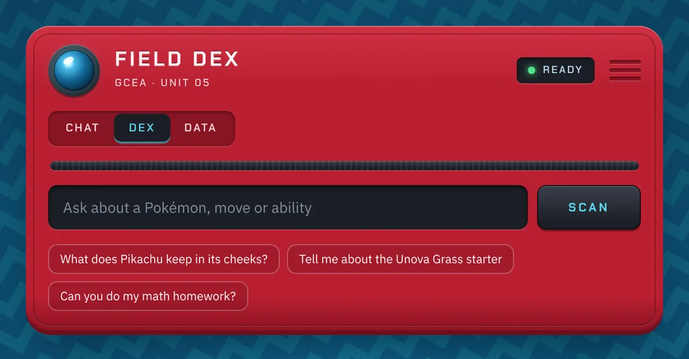
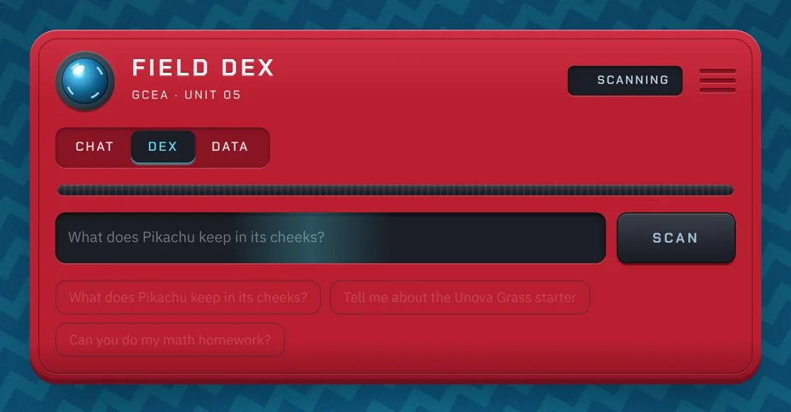
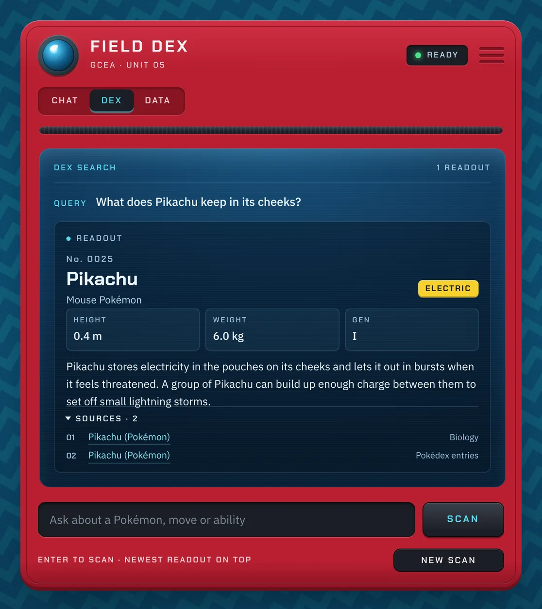
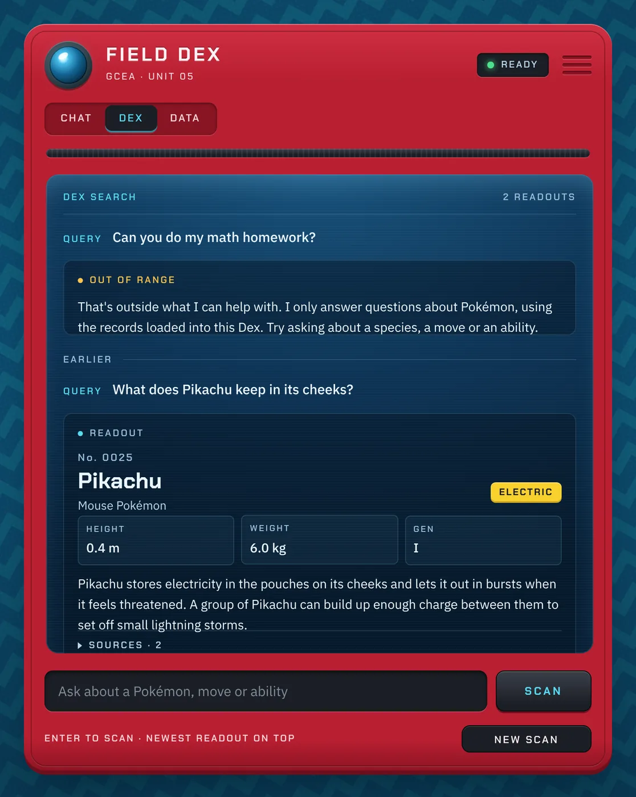

# Field Dex Style Guide

The look and feel of the GottaCatchEmAll chatbot. If you're building or changing anything in the frontend, check here first so every screen feels like the same device.

- **Stylesheet:** `frontend/style.css`
- **Helpers:** `frontend/style.py` (call `apply_style()` once at the top of each page)
- **Theme and fonts:** `.streamlit/config.toml`, fonts in `frontend/static/fonts/`
- **Live preview:** `streamlit run frontend/style_demo.py` from the repo root (canned answers, no backend needed)

---

## 1. The idea

The app is a **handheld field scanner**: a red device sitting on a teal zigzag field. It starts **closed**, showing only a question slot. When there's something to show, its **screen opens** and the answer comes up as a dex-style readout with sources.

Three rules decide every detail:

1. **Everything is part of the device.** Controls look like hardware (recessed slots, raised keys, a status light). If something doesn't belong on a handheld scanner, it doesn't go on the page.
2. **The screen is for content, the shell is for controls.** Answers, entries and sources only ever appear on the blue screen. Inputs and buttons live on the red shell.
3. **Motion explains state.** Every animation tells the user something (scanning, a new readout, the screen opening). Nothing moves just to look busy.

| Closed | Scanning |
|---|---|
|  |  |

| Open | Refusal and earlier readouts |
|---|---|
|  |  |

---

## 2. Color

Defined once as CSS variables at the top of `style.css`. Use the variable, never a raw hex.

### Shell (the red body)
| Token | Hex | Use |
|---|---|---|
| `--fd-shell` | `#B91F31` | Main body color |
| `--fd-shell-hi` | `#CF3043` | Top edge highlight |
| `--fd-shell-lo` | `#8A1323` | Bottom edge, grille slots |
| `--fd-shell-text` | `#FFF1F3` | Text printed on the shell |
| `--fd-shell-text-dim` | `#FFD7DC` | Secondary shell labels |

### Graphite (hardware parts)
| Token | Hex | Use |
|---|---|---|
| `--fd-graphite` | `#1B1E25` | Input slot, status window, buttons |
| `--fd-graphite-2` | `#2A2E37` | Screen bezel |
| `--fd-graphite-3` | `#3A3F4A` | Button top highlight, hinge |

### Screen (the blue glass)
| Token | Hex | Use |
|---|---|---|
| `--fd-glass-top` / `-mid` / `-low` | `#17507A` / `#0D3456` / `#081F35` | Screen gradient, top to bottom |
| `--fd-glass-line` | cyan at 16% | Dividers and panel outlines on the screen |
| `--fd-ink` | `#EAF6FF` | Main text on the screen |
| `--fd-ink-dim` | `#B9D7EA` | Secondary text (category, metadata) |
| `--fd-ink-faint` | `#9BBFD8` | Labels (HEIGHT, No. 0025, section names) |

### Signals
| Token | Hex | Meaning |
|---|---|---|
| `--fd-signal` | `#57D9F0` | Interactive or active: focus rings, active tab, links, the Scan label |
| `--fd-ready` | `#4BE38A` | Status light: ready |
| `--fd-busy` | `#FFC24B` | Working, or a refusal ("out of range") |
| `--fd-fault` | `#FF6B6B` | Something broke (backend down, request failed) |

Cyan means "you can interact with this" or "this is active". Don't use it for decoration.

### Page field
`--fd-field` `#0F5F8A` with `--fd-field-band` `#15779A` zigzag bands, angled at -16° and drifting slowly. A dark vignette at the edges keeps the device the brightest thing on screen.

### Type colors
Each type has one color, set in `TYPE_COLORS` in `style.py`. Badge text switches between white and near-black automatically for contrast, so never hard-code it.

| | | | | | |
|---|---|---|---|---|---|
| Normal `#A8A77A` | Fire `#EE8130` | Water `#6390F0` | Electric `#F7D02C` | Grass `#7AC74C` | Ice `#96D9D6` |
| Fighting `#C22E28` | Poison `#A33EA1` | Ground `#E2BF65` | Flying `#A98FF3` | Psychic `#F95587` | Bug `#A6B91A` |
| Rock `#B6A136` | Ghost `#735797` | Dragon `#6F35FC` | Dark `#705746` | Steel `#B7B7CE` | Fairy `#D685AD` |

---

## 3. Type

Two families, both open source (OFL) and bundled with the app, so they work offline at the demo.

| Font | Role | Where |
|---|---|---|
| **Chakra Petch** 500 / 600 / 700 | Hardware voice | Name plate, labels, status, tabs, button text, entry names, numbers |
| **IBM Plex Sans** 400 / 500 / 600 | Reading voice | Answers, questions, inputs, anything longer than a few words |

Rules:
- **Labels** are Chakra Petch, uppercase, 11 to 12px, tracking `0.16em` to `0.18em`. Example: `SOURCES · 2`, `HEIGHT`, `READY`.
- **Body text** is Plex Sans 15 to 16px, line height 1.6. Never set answer text in all caps.
- **Numbers** that line up (dex numbers, stats) use tabular figures. Dex numbers are always 4 digits: `No. 0025`.
- **Scale:** 11 (labels) · 13 (small body) · 15 (screen body) · 16 (questions, input) · 22 (name plate) · 26 (entry name). Don't add sizes in between.

---

## 4. Shape and spacing

**One radius per family**, so corners always match:

| Family | Radius | Examples |
|---|---|---|
| Shell | 26px | The device body |
| Screen | 14px | The blue screen |
| Controls | 10px | Input slot, buttons, answer panels, tabs track |
| Tags | 6px | Type badges, stat cells, status window |

**Spacing** uses an 8px rhythm (4px for tight internal gaps): 4 · 8 · 12 · 16 · 20 · 24.

**Materials** come from three effects. Reuse them, don't invent new shadows:
- **Raised** (buttons, shell): light top edge, dark bottom edge.
- **Recessed** (input slot, status window, tabs track): inner shadow from the top.
- **Glass** (screen): bezel ring, soft inner glow at the top, 3px scanlines.

---

## 5. Device anatomy

```
┌──────────────────────────────────────────────┐
│ (lens)  FIELD DEX            [● READY]  ═══  │  cap: lens, name plate, status, grille
│         GCEA · UNIT 05                       │
│ [ CHAT | DEX | DATA ]                        │  mode switch
│ ▓▓▓▓▓▓▓▓▓▓▓▓▓▓▓▓▓▓▓▓▓▓▓▓▓▓▓▓▓▓▓▓▓▓▓▓▓▓▓▓▓▓ │  hinge
│ ┌──────────────────────────────────────────┐ │
│ │ DEX SEARCH                    1 READOUT  │ │  screen (only when open)
│ │ QUERY  What does Pikachu keep in its…    │ │
│ │ ┌──────────────────────────────────────┐ │ │
│ │ │ ● READOUT                            │ │ │  answer panel
│ │ │ No. 0025                             │ │ │
│ │ │ Pikachu                   [ELECTRIC] │ │ │
│ │ │ [HEIGHT] [WEIGHT] [GEN]              │ │ │
│ │ │ answer text…                         │ │ │
│ │ │ ▸ SOURCES · 2                        │ │ │
│ │ └──────────────────────────────────────┘ │ │
│ └──────────────────────────────────────────┘ │
│ [ Ask about a Pokémon…            ] [ SCAN ] │  input slot
│ ENTER TO SCAN · NEWEST ON TOP   [ NEW SCAN ] │  base row
└──────────────────────────────────────────────┘
```

The **mode switch** maps to the three things the presentation has to show:
- **Chat:** general conversation with the persona, no retrieval.
- **Dex:** RAG answers from the ingested Bulbapedia pages, with sources.
- **Data:** the data port, for uploading documents to ingest.

---

## 6. States

| State | When | What the user sees |
|---|---|---|
| **Closed** | No readouts yet | Cap, hinge, input slot, three quick-query keys. Status `READY` (green). |
| **Scanning** | First question sent | Device stays closed. Lens pulses and its iris ring spins, status turns `SCANNING` (amber, blinking), a light sweeps across the input slot, and the question shows in the slot. Quick-query keys dim. |
| **Open** | At least one readout | The screen opens between the hinge and the input. The newest readout is on top, and older ones sit under an `EARLIER` divider at 72% opacity. |
| **Receiving** | Follow-up sent while open | A `RECEIVING READOUT` row (amber light plus sweep) appears at the top of the screen. Everything below dims to "earlier". |
| **Refusal** | The bot won't or can't answer | The same panel, labeled `OUT OF RANGE` (or `NO RECORD`) in amber. Calm, not an error. |
| **Fault** | The backend fails | Status `NO SIGNAL`, a red lens glow, and a panel labeled `SIGNAL LOST` with what to try next. |
| **Data** | Data mode | The screen opens straight to the data port: an upload dropzone and collection stats. No input slot. |

**New scan** clears the log and returns to closed.

Why newest-on-top: the device shows the current readout first, like a scanner, so nobody has to scroll down after each answer, and the latest answer is always what's in view during the demo.

---

## 7. Components

All helpers live in `frontend/style.py`. Everything that renders HTML escapes its inputs.

```python
import streamlit as st
import style as fd

fd.apply_style()

with fd.device():
    fd.render_cap("ready")                       # "ready" | "scanning" | "fault"
    mode = st.segmented_control("Mode", ["Chat", "Dex", "Data"], default="Dex",
                                key="fd-mode", label_visibility="collapsed")
    fd.render_hinge()

    if log:                                      # open state
        with fd.screen():
            fd.render_screenbar("DEX SEARCH", "1 READOUT")
            fd.render_query(question)
            fd.render_answer(key="1", text=answer_md, entry=entry, sources=sources)

    with fd.slot(busy=waiting):                  # the input slot
        with st.form("fd-ask", clear_on_submit=True, border=False):
            left, right = st.columns([5, 1.3], vertical_alignment="bottom")
            q = left.text_input("Question", label_visibility="collapsed")
            right.form_submit_button("Scan", use_container_width=True)

fd.render_footer()
```

| Helper | Renders |
|---|---|
| `device()` | The red shell (`st.container`, key `fielddex`). Everything goes inside it. |
| `render_cap(status)` | Lens, name plate, status window, grille. |
| `render_hinge()` | The graphite seam under the cap. |
| `screen()` | The blue screen. Grows with its content and scrolls past `min(62vh, 560px)`. |
| `slot(busy)` | Wrapper for the question form. `busy=True` adds the scan sweep. |
| `render_screenbar(left, right)` | The label strip at the top of the screen. |
| `render_query(text, old)` | The user's question line. |
| `render_answer(key, text, kind, entry, sources, show_frame, old, label)` | One readout panel. `kind` is `"answer"`, `"refusal"` or `"fault"`. |
| `render_entry(entry)` | Dex header: number, name, category, type badges, stat cells. |
| `render_frame(image_url, caption)` | Grid-backed image frame. Shows `NO IMAGE ON FILE` without an image. |
| `render_sources(sources)` | Collapsible provenance list (title link plus section). |
| `type_badges(types)` | Type badge HTML, for use inside other markup. |
| `render_receiving()` / `render_earlier()` / `render_hint()` | Follow-up loader, divider, small shell label. |
| `render_footer()` | Data credit and fan-project disclaimer. |

**What the backend should return** so the UI can render it:

```json
{
  "kind": "answer",
  "text": "Markdown answer text",
  "entry": {"number": 25, "name": "Pikachu", "category": "Mouse Pokémon",
            "types": ["Electric"], "stats": {"HEIGHT": "0.4 m", "WEIGHT": "6.0 kg", "GEN": "I"},
            "image_url": null},
  "sources": [{"title": "Pikachu (Pokémon)", "section": "Biology", "url": "https://bulbapedia…"}]
}
```

`entry` and `sources` are optional (general chat has neither). `kind` is `"refusal"` when guardrails block a question.

---

## 8. Motion

Few animations, each tied to something happening. Easing is `cubic-bezier(0.2, 0.8, 0.2, 1)` everywhere: fast start, soft stop, no bounce.

| Animation | Duration | Trigger |
|---|---|---|
| Device settles in | 260ms | Page load |
| Screen opens (unclips top to bottom) | 560ms | First readout |
| Screen powers on (brightness flicker) | 420ms, after 220ms | Right after it opens |
| Readout rises in | 260ms | Each new question and answer |
| Lens pulse and iris spin | 1.2s / 1.6s loop | While scanning |
| Status light blink | 0.9s loop | While scanning |
| Slot and receiving sweep | 1.2 to 1.4s loop | While waiting on the model |
| Field drift | 90s loop | Always, barely noticeable |
| Hover and press | 140ms | Buttons, tabs, quick keys |

Rules:
- **No bounce, wiggle or overshoot.** Buttons press down 2px; they don't grow, lift or rotate.
- **Loops only while waiting.** Once the answer lands, everything on screen stands still.
- **Reduced motion:** with the OS "reduce motion" setting on, every animation is switched off and the states still read correctly.
- **Known limit:** Streamlit redraws the page, so the screen can't animate closed. New scan simply returns to the closed layout.

---

## 9. Voice and copy

The bot is a field device's assistant: friendly, precise, short. It calls the user "Trainer" now and then, not every message.

- **Labels sound like hardware:** `READY`, `SCANNING`, `READOUT`, `OUT OF RANGE`, `NO SIGNAL`. Uppercase, short.
- **Answers sound like a person:** plain sentences, two or three short paragraphs at most. No emoji.
- **Refusals stay calm and redirect:** say what it can't do, then what it can. Example: "That's outside what I can help with. I only answer questions about Pokémon, using the records loaded into this Dex. Try asking about a species, a move or an ability."
- **Unknowns are honest:** "I couldn't find that in the records I have, so I'd rather not guess."
- **No filler.** No "Unlock the power of Pokémon knowledge!" taglines.

---

## 10. Accessibility

- Every text color passes WCAG AA (4.5:1) on the surface it sits on, including the faint screen labels and the shell text. Check new colors before adding them.
- Every interactive element has a visible cyan focus ring (`:focus-visible`).
- The status window uses `role="status"`, so screen readers announce `SCANNING`.
- Decorative parts (lens, grille, hinge) are `aria-hidden`.
- Reduced motion is respected (see section 8).
- The layout holds at 390px wide: the grille and serial hide, the lens shrinks, and the Scan button stays beside the input.

---

## 11. Don'ts

These are the habits that make a UI look auto-generated. Avoid them:

- **No purple gradients, glows or sparkle icons.** Our palette is red, graphite, blue glass and cyan, nothing else.
- **No emoji as icons**, in buttons, headings or bot answers.
- **No hover lifts, scale-ups or bouncy animations.**
- **No new radii, shadows or font sizes.** Pick from sections 3 and 4.
- **No placeholder copy left in the app** (lorem ipsum, "Made by me", fake stats). The demo page's numbers are marked `DEMO VALUES`.
- **No buttons that do nothing.** Every visible control works, or it isn't there.
- **No Pokémon artwork drawn into the UI chrome**, and no official logos or device designs copied. The device is our own design; only the data (names, types, descriptions) comes from Bulbapedia.

---

## 12. Working with the styles

- **Keys matter.** Styling hooks onto Streamlit keys: `fielddex`, `fd-mode`, `fd-screen`, `fd-slot` / `fd-slot-busy`, `fd-ans-…`, `fd-try-…`, `fd-reset`. Keep those keys if you rebuild a section.
- **Never put model or scraped text into `st.html`.** Answers go through `st.markdown` (no unsafe HTML), so nothing from the LLM or the data can inject markup. The helpers escape everything else.
- **Never put `<` or `>` in `style.css`**, even in comments. Streamlit sanitizes the stylesheet, and one stray `<` silently drops the whole thing.
- **Run from the repo root** (`streamlit run frontend/app.py`), or Streamlit won't find `.streamlit/config.toml` and the fonts won't load.
- **Changing a token?** Update this guide in the same PR.
